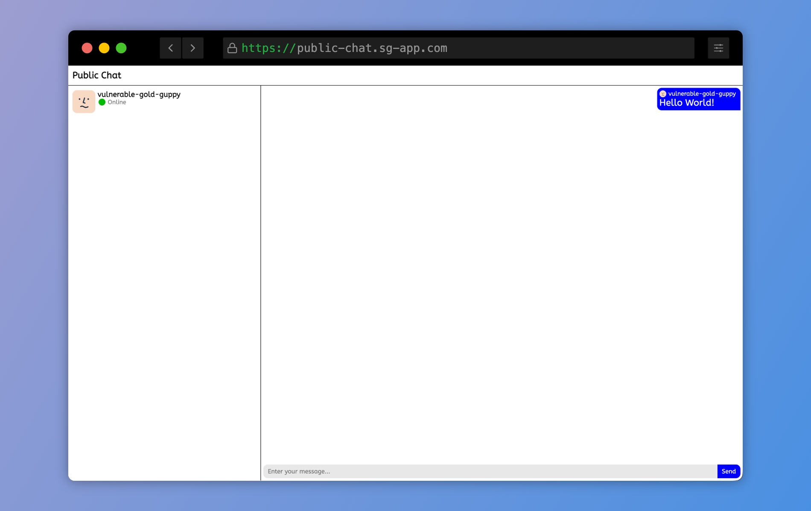

# Public Chat
A completely free & anonymous global chat app with smart instant moderation.

### Purpose
This app enables the world to discuss on a single topic at a time. It's made to enable everyone discussing topics together in a safe and open environment.

### Tech stack
- Typescript: Programming language
- Bun: Core runtime
- Websockets: Realtime communication
- Redis: Quick storage of messages
- Dicebear: Avatar generation
- React: Frontend Framework
- Cloudflare Workers AI: Utilizing AI in moderation
- Clef Flash: Model used for instant moderation of messages

### Moderation
Moderation is handled by Cloudflare Clef Flash hosted on Cloudflare Workers AI. The moderation check is done in under 2 seconds in most cases.

Moderation code & parameters are completely open source, available in [src/utils/moderate.ts](src/utils/moderate.ts).

### Repository Structure
Main branch: Deployed in production  
Preview branch: Deployed in preview for testing  
Other branches: Active development branches

Each environment has its own separate application and database.  
Preview URL: https://public-chat-preview.sg-app.com  
Production URL: https://public-chat.sg-app.com

### Deployment
This app can be easily deployed using Docker

Requirements:
- Redis Server
- Docker

Current online hosted version:
The app & database is completely hosted on my own server located in Frankfurt, Germany.  

### Environment Variables
| Name | Type | Required | Default | Purpose |
| - | - | - | - | - |
| CF_ACC_ID | string | ✅ | - | Cloudflare Account ID |
| CF_AI_API_KEY | string | ✅ | - | Cloudflare Workers AI API key |
| REDIS_URL | string | ✅ | - | Redis connection URL |
| IP_HASH_SECRET | string | ✅ | - | The salt used at the time of IP address hashing. Can be easily generated using `openssl rand -hex 32` |
| MAX_MESSAGES | number | ❌ | 30 | Maximum number of messages retrieved |
| BUN_PUBLIC_MESSAGE_SIZE_LIMIT | number | ❌ | 400 | Maximum individual message characters |
| RL_COUNT | number | ❌ | 30 | Number of messages send in the rate limit period |
| RL_PERIOD | number | ❌ | 86400 (24 hours) | Rate limit period in seconds |
| RL_PERIOD | number | ❌ | 86400 (24 hours) | Rate limit period in seconds |
| BAD_MESSAGES_LIMIT | number | ❌ | 3 | Number of messages after which ban will be triggered |
| BAD_MESSAGES_BAN_PERIOD | number | ❌ | 86400 (24 hours) | Amount of time the user will be banned for in seconds |
| BUN_PUBLIC_UMAMI_SCRIPT_URL | url | ❌ | - | Umami analytics script URL (optional) |
| BUN_PUBLIC_UMAMI_WEBSITE_ID | string | ❌ | - | Umami analytics website id (optional) |

### Disclosure
No AI has been used in the development of this application. It's completely handwritten by me. This is one of my projects I built to prove I can code both with and without AI, this one being a non-AI one.